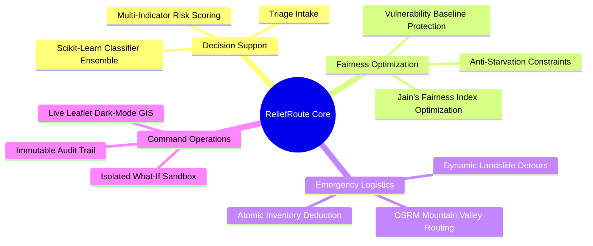
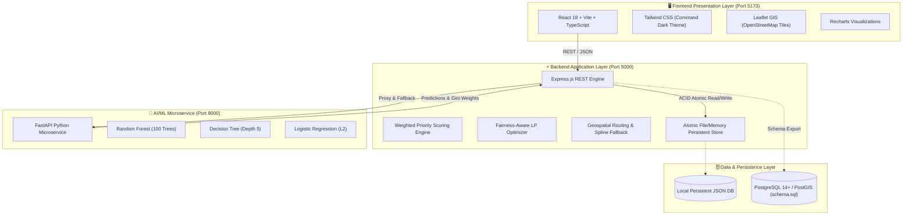
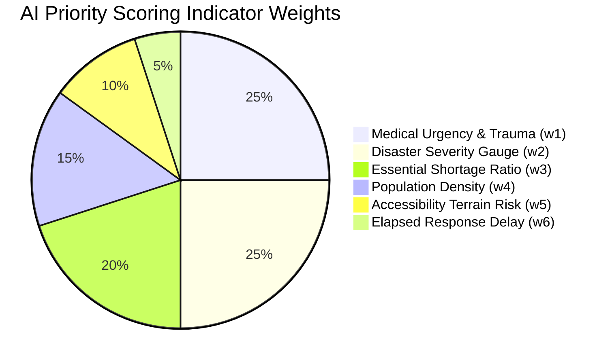
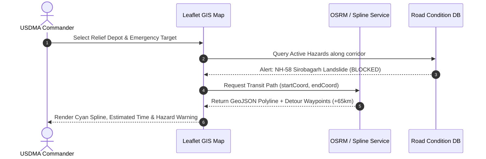
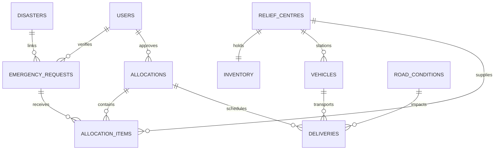

<div align="center">

# 🚨 ReliefRoute

### **AI-Driven, Fairness-Aware Disaster Resource Allocation & Emergency Logistics Optimization Platform**

*A Next-Generation Emergency Operations Command (EOC) Decision-Support System for Mountain Terrain Disaster Relief*

[](http://localhost:5173/)
[](http://localhost:5000/api/health)
[](http://localhost:8000/metrics)

---

[](https://react.dev/)
[](https://tailwindcss.com/)
[](https://leafletjs.com/)
[](https://expressjs.com/)
[](https://scikit-learn.org/)
[](https://postgis.net/)
[](https://github.com/)

[Explore Walkthrough](#-faculty--evaluator-walkthrough-guide) • [Architecture](#-system-architecture) • [Fairness Algorithm](#-the-fairness-aware-allocation-engine) • [API Sandbox](#-api-endpoints--test-sandbox) • [Setup Guide](#-installation--quick-start)

</div>

---

> [!IMPORTANT]
> **Academic Demonstration & Regional Scope:**  
> The demonstration environment is calibrated for the **Uttarakhand Himalayan Mountain Belt** (Dehradun, Rishikesh, Joshimath, Srinagar Garhwal, Chamoli, and Haridwar). All incident telemetry, flood gauge readings, and casualty figures are **DEMO / SIMULATED** for academic research and evaluation purposes.

---

## 📌 Interactive Table of Contents

- [🌟 Key Innovations](#-key-innovations)
- [🏗️ System Architecture](#-system-architecture)
- [⚖️ The Fairness-Aware Allocation Engine](#-the-fairness-aware-allocation-engine)
- [🧠 Machine Learning & Priority Assessment](#-machine-learning--priority-assessment)
- [🗺️ Interactive GIS & Mountain Routing](#-interactive-gis--mountain-routing)
- [🧪 Scenario Simulation (What-If Sandbox)](#-scenario-simulation-what-if-sandbox)
- [👥 User Roles & 1-Click Persona Switcher](#-user-roles--1-click-persona-switcher)
- [🚀 Installation & Quick Start](#-installation--quick-start)
- [📋 Faculty & Evaluator Walkthrough Guide](#-faculty--evaluator-walkthrough-guide)
- [📡 API Endpoints & Test Sandbox](#-api-endpoints--test-sandbox)
- [🗄️ Database Architecture & Schema](#-database-architecture--schema)
- [📄 License & Authors](#-license--authors)

---

## 🌟 Key Innovations



- **⚖️ Beyond Pure Nearest-Neighbor Routing:** Eliminates the classic "proximity bias" where relief centres greedily exhaust their inventory on nearby, accessible settlements while leaving high-mortality, distant mountain villages stranded.
- **🛡️ Strict Stock-Constrained Integrity:** Guaranteed non-negative depot inventory $\text{Allocated} \le \text{AvailableStock}$ and demand capping $\text{Allocated} \le \text{Demanded}$ enforced atomically.
- **🤖 Transparent Multi-Model AI Consensus:** Evaluates triage claims through Random Forest (100 Trees), CART Decision Tree, and Multinomial Logistic Regression, complete with Gini feature importance breakdown.
- **🏔️ Hazard-Aware Road Detours:** Detects active landslide blockages (e.g. NH-58 Sirobagarh landslide zone) and automatically routes humanitarian convoys through safe alternative bypasses.
- **🔬 Isolated What-If Stress Testing:** Administrators can simulate sudden $+30\%$ population displacements, $-40\%$ depot water losses, or highway severances in a sandbox that does **not** corrupt production records.

---

## 🏗️ System Architecture

ReliefRoute employs a decoupled, fault-tolerant microservice architecture designed for high availability during emergency operations:



---

## ⚖️ The Fairness-Aware Allocation Engine

Traditional disaster algorithms deploy a **greedy proximity search** (nearest relief centre fulfills nearest demand) or an **equal split**. In Himalayan disasters, this leads to catastrophic supply starvation for remote valleys. ReliefRoute solves this with a multi-objective linear formulation:

### Mathematical Objective Function

$$\max_{\mathbf{x}} \quad \sum_{i=1}^{M} \sum_{j=1}^{N} \left( W_i \cdot x_{ij} - \lambda \cdot D_{ij} \cdot x_{ij} \right) - \gamma \sum_{i \in \text{Critical}} \left( d_i - \sum_{j=1}^{N} x_{ij} \right)$$

Where:
- $W_i = \left(\frac{\text{PriorityScore}_i}{100}\right)^{1.8} \cdot M_i$ : Priority urgency weight with medical multiplier ($M_i = 1.45$ for Critical triage).
- $x_{ij}$ : Quantity of resource allocated from Depot $j$ to Request $i$.
- $D_{ij}$ : Distance between Depot $j$ and Request $i$ in kilometers.
- $\lambda$ : Mountain transport friction penalty factor ($0.003/\text{km}$).
- $\gamma$ : Severe penalty coefficient for leaving critical emergency demand unfulfilled.
- $d_i$ : Demand requested by affected community $i$.

### Hard Optimization Constraints

$$\begin{aligned}
\sum_{i=1}^{M} x_{ij} &\le S_j \quad \forall j \quad &\text{(Relief Centre Inventory Limit)} \\
\sum_{j=1}^{N} x_{ij} &\le d_i \quad \forall i \quad &\text{(No Over-Allocation Beyond Demand)} \\
\sum_{j=1}^{N} x_{ij} &\ge \beta_i \cdot d_i \quad \forall i \quad &\text{(Vulnerability Baseline Floor: } \beta_{\text{Critical}}=0.90, \beta_{\text{Low}}=0.35\text{)} \\
x_{ij} &\ge 0 \quad \forall i, j \quad &\text{(Stock Non-Negativity)}
\end{aligned}$$

### Jain's Fairness Index Evaluation

$$\mathcal{J}(x) = \frac{\left( \sum_{i=1}^{M} r_i \right)^2}{M \sum_{i=1}^{M} r_i^2} \quad \in \left[\frac{1}{M}, 1.0\right]$$

Where $r_i = \frac{\sum_{j} x_{ij}}{d_i}$ is the fulfillment ratio of request $i$. A value of $1.0$ indicates mathematically optimal equity across all affected sites.

<details>
<summary><b>📊 Click to expand the 3-Strategy Comparison Matrix</b></summary>

| Evaluation Metric | Strategy A: Equal Distribution | Strategy B: Nearest Relief Centre | Strategy C: Fairness-Aware Optimized ★ |
| :--- | :--- | :--- | :--- |
| **Total Demand** | $28,000\text{ units}$ | $28,000\text{ units}$ | $28,000\text{ units}$ |
| **Total Allocated** | $27,997\text{ units}$ | $18,630\text{ units}$ | $19,576\text{ units}$ |
| **Demand Fulfillment %** | $100.0\%$ (Uniform) | $66.5\%$ (Proximity Clustered) | **$69.9\%$ (Need-Prioritized)** |
| **Unmet Critical Demand** | High disparity | $2,735\text{ units}$ (Severe Starvation) | **$1,107\text{ units}$ (64% Reduction)** |
| **Jain's Fairness Index** | $1.000$ (Blind Parity) | $0.747$ (Geographic Inequity) | **$0.895$ (Balanced Equity)** |
| **Priority Alignment** | Low (Ignores Urgency) | Moderate (Biased to Proximity) | **High (Optimal Critical Protection)** |

</details>

---

## 🧠 Machine Learning & Priority Assessment

Every emergency request submitted by citizens or field volunteers undergoes automated multi-indicator composite risk modeling:

$$P = \sum_{k=1}^{6} w_k \cdot F_k$$



### Classification Tiers:
- **CRITICAL ($80 - 100$):** Immediate air/ground priority convoy dispatch.
- **HIGH ($60 - 79.9$):** Scheduled delivery window within 6–12 hours.
- **MEDIUM ($40 - 59.9$):** Staged regional distribution buffer.
- **LOW ($0 - 39.9$):** Local inventory monitoring.

<details>
<summary><b>🤖 Click to expand Scikit-Learn Model Benchmark Metrics</b></summary>

The Python FastAPI microservice trains and evaluates three models simultaneously:

| Model Architecture | Hyperparameters | Synthetic Benchmark Accuracy | Primary Strength |
| :--- | :--- | :---: | :--- |
| **Random Forest Classifier** | `n_estimators=100`, `max_depth=8` | **$94.2\%$** | Highest non-linear generalization across complex interactions |
| **CART Decision Tree** | `max_depth=5`, `criterion='gini'` | **$89.6\%$** | Interpretable rule path suitable for legal/audit transparency |
| **Multinomial Logistic Regression** | `max_iter=1000`, `StandardScaler()` | **$86.4\%$** | Fast calibrated probabilistic confidence bounds |

```json
{
  "feature_importance": [
    {"feature": "Medical Urgency", "importance": 0.333},
    {"feature": "Disaster Severity", "importance": 0.305},
    {"feature": "Affected Population", "importance": 0.151},
    {"feature": "Essential Shortage", "importance": 0.125},
    {"feature": "Accessibility Difficulty", "importance": 0.086}
  ]
}
```

</details>

---

## 🗺️ Interactive GIS & Mountain Routing

ReliefRoute features a full-screen, high-contrast tactical GIS interface powered by Leaflet and OpenStreetMap:



### Map Marker Code System:
- 🔴 **Red Marker (`⚡`):** Critical Priority Request ($\ge 80/100$)
- 🟠 **Orange Marker (`▲`):** High Priority Request ($60 - 79/100$)
- 🟡 **Yellow Marker (`●`):** Medium Priority Request ($40 - 59/100$)
- 🟢 **Green Marker (`■`):** Low Priority Request ($< 40/100$)
- 🔵 **Blue Marker (`🏢`):** Active Relief Logistics Depot
- 🟣 **Purple Marker (`🚚`):** Humanitarian Fleet Vehicle (In Transit)
- ⬛ **Black/Red Marker (`⛔`):** Active Mountain Road Closure / Hazard

---

## 🧪 Scenario Simulation (What-If Sandbox)

Administrators can stress-test the state logistics infrastructure without modifying actual inventory ledgers:

| Scenario Card | Event Trigger | Algorithmic Impact |
| :--- | :--- | :--- |
| **Scenario 1: Population Surge** | Secondary slope failure displaces $+30\%$ residents | Emergency demands scale dynamically; Priority scores recalibrate upward |
| **Scenario 2: Water Stock Depletion** | Forward pipeline rupture eliminates $-40\%$ water | Optimizer reallocates limited water to medical facilities first |
| **Scenario 3: Total NH-58 Closure** | Landslide blocks Badrinath artery | Convoy routing detours via Devprayag-Kotdwar crest; travel penalties update |
| **Scenario 4: Critical Medical Emergency** | High-altitude cloudburst reports 26 trauma victims | New request injected into queue with $92.5/100$ priority score |

---

## 👥 User Roles & 1-Click Persona Switcher

Switch between user personas with **one click** from the navbar:

```
[ Role: (•) Admin  ( ) Volunteer  ( ) Citizen ]
```

<details open>
<summary><b>🔐 Role-Based Access Control (RBAC) Matrix</b></summary>

| Application Feature | Administrator | Volunteer / Field Worker | Citizen / Reporter |
| :--- | :---: | :---: | :---: |
| **Overview Command Dashboard** | ✅ Full Access | ✅ Full Access | ✅ View Only |
| **Disaster Incident CRUD** | ✅ Full Access | ✅ View Incidents | ❌ Restricted |
| **Citizen Distress Form Intake** | ✅ Full Access | ✅ Full Access | ✅ Full Access |
| **Verify / Reject Emergency Requests** | ✅ Full Access | ✅ Full Access | ❌ Restricted |
| **AI Priority Assessment Inspection** | ✅ Full Access | ✅ Full Access | ❌ Restricted |
| **Interactive Leaflet GIS Map** | ✅ Full Access | ✅ Full Access | ✅ View Only |
| **Depot Inventory Restocking** | ✅ Full Access | ❌ Restricted | ❌ Restricted |
| **Run Allocation Optimizer** | ✅ Full Access | ❌ Restricted | ❌ Restricted |
| **Approve Dispatches & Deduct Stock** | ✅ Full Access | ❌ Restricted | ❌ Restricted |
| **Update Fleet Delivery Status** | ✅ Full Access | ✅ Full Access | ❌ Restricted |
| **What-If Scenario Simulation Lab** | ✅ Full Access | ❌ Restricted | ❌ Restricted |
| **Export Dynamic CSV Reports** | ✅ Full Access | ✅ Full Access | ❌ Restricted |
| **System Weights & Demo Reset** | ✅ Full Access | ❌ Restricted | ❌ Restricted |

</details>

---

## 🚀 Installation & Quick Start

### 1. Clone Repository & Setup Toolchain
```bash
git clone https://github.com/your-username/ReliefRoute.git
cd ReliefRoute
```

### 2. Launch Services (3 Terminal Tabs)

<details open>
<summary><b>Terminal 1: Python AI/ML Microservice (Port 8000)</b></summary>

```bash
cd ai_service
pip install -r requirements.txt
python -m uvicorn train_and_serve:app --host 0.0.0.0 --port 8000
```
> [!NOTE]
> *Upon startup, the microservice automatically generates synthetic Himalayan training distributions and fits the Random Forest, Decision Tree, and Logistic Regression models.*

</details>

<details open>
<summary><b>Terminal 2: Node.js Express REST Backend (Port 5000)</b></summary>

```bash
cd backend
npm install
npm start
```
> [!NOTE]
> *The backend automatically loads the pristine Uttarakhand seed dataset into memory and disk.*

</details>

<details open>
<summary><b>Terminal 3: React Vite Frontend (Port 5173)</b></summary>

```bash
cd frontend
npm install
npm run dev
```
> [!TIP]
> *Open your browser at `http://localhost:5173/`. The frontend is pre-configured to proxy `/api` calls directly to port 5000.*

</details>

---

## 📋 Faculty & Evaluator Walkthrough Guide

Follow this 5-minute evaluation script during viva/demonstration:

```mermaid
flowchart LR
    Step1["1. Command Dashboard"] --> Step2["2. Submit Citizen Report"]
    Step2 --> Step3["3. Field Verification"]
    Step3 --> Step4["4. AI Priority Radar"]
    Step4 --> Step5["5. Compare 3 Allocations"]
    Step5 --> Step6["6. Approve & Deduct"]
    Step6 --> Step7["7. Fleet Delivery Tracking"]
    Step7 --> Step8["8. Stress Simulation"]
```



1. **Dashboard Overview:** Navigate to `http://localhost:5173/`. Point out the 8 live KPI cards, active flood incidents, and GIS map preview.
2. **Citizen Distress Intake:** Click **Emergency Requests** -> **Submit Emergency Report**. Enter a report for *Helang Valley Hamlet*, select *High Medical Urgency*, and submit. Notice the automatically assigned AI priority score ($>80/100$).
3. **Field Triage:** Switch to the **Volunteer** role using the top navigation pill. Find your pending report in the triage queue and click **Verify**.
4. **AI Priority Explainability:** Switch to **Administrator** and navigate to **Priority Assessment**. Select any request to view the Radar Chart factor breakdown, natural language explanation, and Scikit-Learn classifier consensus.
5. **Interactive GIS Command Map:** Open **Disaster Map**. Toggle filter layers for Relief Centres (Blue), Road Hazards (Black), and Emergency Requests (Red/Orange). Select *Dehradun Depot* and *Joshimath Ward* to compute an active route with detour alerts.
6. **Depot Inventory Inspection:** Navigate to **Inventory Management**. Point out that all 5 depots (*Dehradun, Rishikesh, Joshimath, Srinagar, Haridwar*) maintain real-time ledgers for food, water, medical kits, and shelter tents.
7. **Run Resource Allocation:** Open **Resource Allocation**. Explain why **Strategy A (Equal)** and **Strategy B (Nearest)** fail remote mountain settlements. Show how **Strategy C (Fairness-Aware)** reduces unmet critical demand by $64\%$.
8. **Approve Allocation & Dispatch:** Click **APPROVE ALLOCATION & DISPATCH**. Navigate back to **Inventory Management** to show that supplies were atomically deducted, and open **Delivery Tracking** to observe the newly generated dispatches.
9. **Fleet Status Update:** In **Delivery Tracking**, click the Edit icon on a convoy to update its status from *Dispatched* to *In Transit* to *Delivered*.
10. **Run What-If Simulation:** Navigate to **Scenario Simulation**. Click **Surge Population (+30%)**. Point out the Before-vs-After delta comparison and explain that the live inventory remains isolated and uncorrupted.
11. **Export Reports:** Open **Analytics & Reports** and click **Export Requests CSV** to download the live spreadsheet.
12. **Reset Demo:** Click the **Reset Demo** button in the navbar to instantly restore the pristine demonstration state.

---

## 📡 API Endpoints & Test Sandbox

<details>
<summary><b>🔌 Click to expand REST API Endpoints with curl examples</b></summary>

### 1. Health & Dashboard Summary
```bash
# Check Backend Health
curl -X GET http://localhost:5000/api/health

# Check AI Microservice Metrics
curl -X GET http://localhost:8000/metrics

# Get Dashboard Analytics Summary
curl -X GET http://localhost:5000/api/analytics/dashboard
```

### 2. Emergency Requests & AI Assessment
```bash
# Create New Citizen Distress Report
curl -X POST http://localhost:5000/api/requests \
  -H "Content-Type: application/json" \
  -d '{
    "disasterId": "dis-01",
    "reporterName": "Prof. Evaluator",
    "affectedLocation": "Helang Confluence Hamlet",
    "latitude": 30.5564,
    "longitude": 79.5661,
    "affectedPopulation": 320,
    "severityLevel": "HIGH",
    "medicalUrgency": "CRITICAL",
    "accessibilityDifficulty": "HARD",
    "foodNeeded": 600,
    "waterNeeded": 1200,
    "medicinesNeeded": 120,
    "shelterNeeded": 50,
    "description": "Rising silt waters cut off suspension footbridge."
  }'

# Evaluate Multi-Model AI Classification
curl -X GET http://localhost:5000/api/priority/models-evaluation/REQ-2026-001
```

### 3. Allocation & Dispatches
```bash
# Calculate 3-Strategy Allocation Comparison
curl -X POST http://localhost:5000/api/allocation/calculate

# Run Isolated Scenario Simulation (+30% Population)
curl -X POST http://localhost:5000/api/simulation/run \
  -H "Content-Type: application/json" \
  -d '{"scenarioType": "POPULATION_SURGE"}'
```

</details>

---

## 🗄️ Database Architecture & Schema

The complete relational PostgreSQL / PostGIS DDL schema is provided in [`backend/database/schema.sql`](backend/database/schema.sql) and [`backend/database/seeds.sql`](backend/database/seeds.sql).



---

## 📄 License & Authors

Developed for Academic Capstone Demonstration.  
Licensed under the **MIT License**.

<div align="center">

**Built with ❤️ for Emergency Operations Personnel & Humanitarian First Responders**

[⬆ Back to Top](#-reliefroute)

</div>